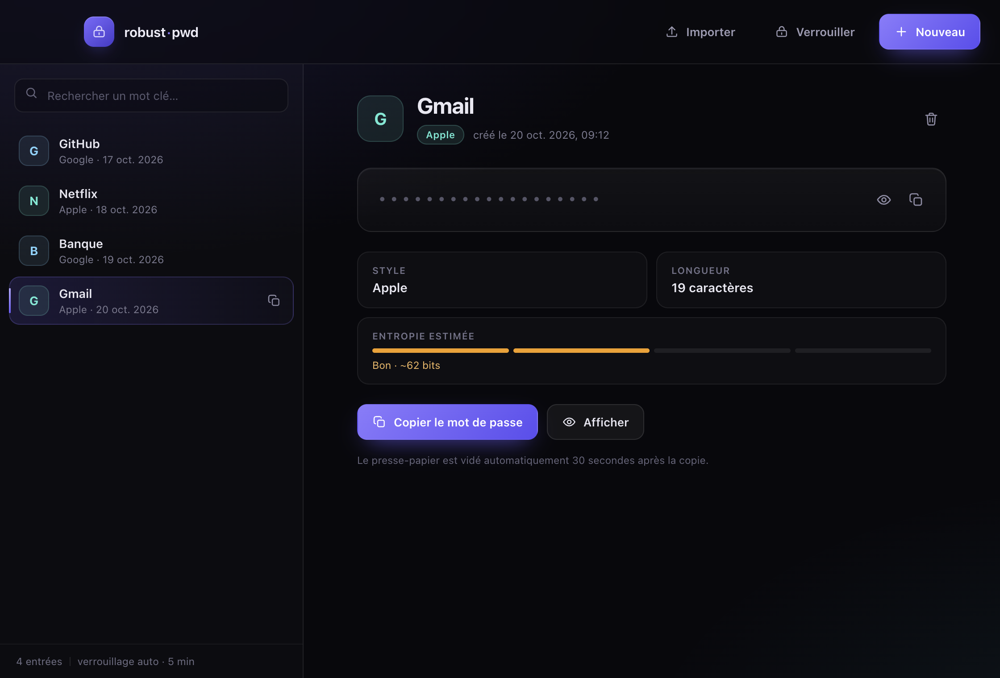

# robust-pwd

[](https://github.com/Nyamek0/robust-pwd/actions/workflows/ci.yml)

Générateur de mots de passe robuste avec coffre chiffré local.

Génère des mots de passe forts à la manière d'Apple (prononçable) ou Google (aléatoire), et les sauvegarde dans un fichier chiffré AES-256-GCM sur ta machine. Aucune donnée n'est envoyée sur internet.

Deux interfaces, un seul coffre : un **CLI Python** (`pwdgen.py`) et une **application desktop Electron + React** (`desktop/`).

---

## Interface desktop (Electron + React)

L'application de bureau lit et écrit **le même coffre** que le CLI (`~/.robust-pwd/vault.enc`), au même format binaire. Tu peux passer de l'un à l'autre sans migration.



### Télécharger l'application

Les installeurs sont générés par GitHub Actions et publiés dans les [Releases](https://github.com/Nyamek0/robust-pwd/releases/latest) :

| Système | Fichier |
|---|---|
| macOS (Apple Silicon et Intel) | `robust-pwd-<version>-universal.dmg` |
| Windows 10/11 (x64) | `robust-pwd-Setup-<version>-x64.exe` |
| Linux (x64) | `robust-pwd-<version>-x64.AppImage` |

Les builds ne sont pas signés ni notarisés. Au premier lancement :

- **macOS** : clic droit sur l'application → **Ouvrir**. En cas de blocage persistant :
  ```bash
  xattr -dr com.apple.quarantine /Applications/robust-pwd.app
  ```
- **Windows** : SmartScreen → **Informations complémentaires** → **Exécuter quand même**.
- **Linux** : `chmod +x robust-pwd-*.AppImage` puis lance le fichier.

Chaque Release contient aussi `SHA256SUMS.txt` pour vérifier l'intégrité des fichiers.

### Lancer depuis les sources

Prérequis : Node.js 22.12+ et npm.

```bash
cd desktop
npm install
npm run dev
```

### Compiler, tester, packager

```bash
cd desktop
npm run build      # bundles de production dans out/
npm run typecheck  # vérification TypeScript stricte
npm test           # tests du coffre + compatibilité avec pwdgen.py
npm run dist       # DMG universel, .exe ou .AppImage dans release/
```

La CI GitHub Actions teste macOS, Windows et Linux à chaque push. Un tag `v*` déclenche la construction et la publication des installeurs dans les Releases.

> L'application n'est pas signée. Au premier lancement sur macOS, utilise clic droit → « Ouvrir » si Gatekeeper la bloque.

### Ce que l'app ajoute au CLI

| Fonction | Détail |
|---|---|
| Déverrouillage / création du coffre | Écran dédié, confirmation et jauge de robustesse du mot de passe maître |
| Navigation | Liste recherchable, détail d'une entrée, suppression avec confirmation |
| Générateur | Styles Apple, Google ou les deux, longueur réglable (12–48), régénération instantanée |
| Import | Saisie manuelle ou fichier CSV / TSV / JSON, doublons et lignes invalides ignorés |
| Entropie | Estimation affichée en bits pour chaque proposition et chaque entrée générée |
| Presse-papier | Copie en un clic, vidage automatique après 30 s si le contenu n'a pas changé |
| Verrouillage | Manuel (bouton) ou automatique après 5 minutes d'inactivité |

### Raccourcis clavier

| Raccourci | Action |
|---|---|
| `⌘N` / `Ctrl+N` | Nouveau mot de passe |
| `⌘L` / `Ctrl+L` | Verrouiller le coffre |
| `⌘F` / `Ctrl+F` | Rechercher |
| `Échap` | Fermer la fenêtre modale |

### Importer des mots de passe existants

Deux méthodes, entièrement locales :

1. **À la main** — bouton « Nouveau », onglet « Saisir » : donne un mot clé et colle le mot de passe à conserver. Il est enregistré tel quel (avec une estimation de robustesse).
2. **Par fichier** — bouton « Importer » dans la barre du haut : sélectionne un fichier **CSV**, **TSV** ou **JSON**. Les doublons (même mot clé + même mot de passe), les lignes vides et les entrées invalides sont ignorés, puis un résumé s'affiche.

Un fichier CSV peut utiliser une virgule, un point-virgule ou une tabulation. L'en-tête est facultatif, mais recommandé ; les colonnes reconnues sont `label`, `name`, `title`, `site`, `url`, `account`, `login`, `username` pour le mot clé, et `password`, `pass`, `secret`, `mot de passe` pour le mot de passe.

```csv
label,password
GitHub,Kj#9mLpQ2$vXn8!wR#
Banque,"Abc,def"
```

```json
[
  { "label": "GitHub", "password": "Kj#9mLpQ2$vXn8!wR#" },
  { "name": "Banque", "secret": "Abc,def" }
]
```

Les formats `{ "entries": [...] }` et les exports Bitwarden `{ "items": [{ "name", "login": { "password" } }] }` sont aussi acceptés. Limite : 5 Mo et 1 000 entrées par fichier. Les mots de passe importés portent le style `custom` (affiché « Importé ») et restent lisibles par le CLI Python.

### Utiliser un autre coffre

```bash
ROBUST_PWD_VAULT=/chemin/vers/vault.enc npm run dev
```

### Sécurité côté desktop

- Le coffre n'est déchiffré que dans le **processus principal** ; l'interface ne reçoit que les métadonnées, et un mot de passe n'est transmis qu'à la demande explicite (« Afficher » ou « Copier »).
- `contextIsolation`, `sandbox`, `nodeIntegration: false`, aucune navigation externe, aucune requête réseau.
- Preload minimal via `contextBridge`, CSP stricte injectée au build.
- Écriture atomique (fichier temporaire puis `rename`), permissions `700` sur le dossier et `600` sur le fichier.
- Instance unique : deux fenêtres ne peuvent pas écraser le même coffre.
- Les tests `desktop/tests/vault.test.ts` vérifient qu'un coffre écrit par l'app est lisible par le CLI Python, et inversement.

---

## Fonctionnalités

- Deux styles de mots de passe : **Apple** (`xovuk-8Nevqe-hidwuf`) et **Google** (`Kj#9mLpQ2$vXn8!wR`)
- Chaque mot de passe est associé à un **mot clé** (ex : GitHub, Netflix)
- Coffre chiffré **AES-256-GCM** avec dérivation de clé PBKDF2 (600 000 itérations)
- Mot de passe maître défini par l'utilisateur — jamais stocké dans le code
- Copie automatique dans le presse-papier
- Fonctionne en mode **menu interactif** ou **sous-commandes directes**

---

## Prérequis

- **Python 3.8+** et **pip** pour le CLI
- **Node.js 22.12+** et **npm** pour l'interface desktop (facultatif)

Vérifier ta version de Python :
```bash
python3 --version
```

---

## Installation

### 1. Cloner le dépôt

```bash
git clone https://github.com/<ton-utilisateur>/robust-pwd.git
cd robust-pwd
```

### 2. Installer la dépendance

```bash
pip install -r requirements.txt
```

> Si `pip` ne fonctionne pas, essaie `pip3` ou `python3 -m pip install -r requirements.txt`.

---

## Lancer le script

Sans commande globale, tu peux toujours lancer le script directement :

```bash
python3 pwdgen.py
```

---

## Commande globale `robust-pwd` (optionnel mais recommandé)

Cette étape te permet de taper `robust-pwd` depuis n'importe quel terminal.

### macOS / Linux

```bash
# Rendre le script exécutable
chmod +x pwdgen.py

# Créer le dossier s'il n'existe pas
mkdir -p ~/.local/bin

# Créer un lien symbolique
ln -sf "$(pwd)/pwdgen.py" ~/.local/bin/robust-pwd
```

Ensuite, ajouter `~/.local/bin` à ton PATH si ce n'est pas déjà fait.

**macOS (zsh) :**
```bash
echo 'export PATH="$HOME/.local/bin:$PATH"' >> ~/.zshrc
source ~/.zshrc
```

**Linux (bash) :**
```bash
echo 'export PATH="$HOME/.local/bin:$PATH"' >> ~/.bashrc
source ~/.bashrc
```

Vérifier que ça fonctionne :
```bash
robust-pwd
```

---

### Windows

**Option A — PowerShell (recommandée)**

1. Ouvre PowerShell en tant qu'administrateur et crée un dossier pour tes scripts :

```powershell
New-Item -ItemType Directory -Force -Path "$env:USERPROFILE\scripts"
```

2. Crée un fichier `robust-pwd.bat` dans ce dossier :

```powershell
$scriptPath = (Get-Location).Path + "\pwdgen.py"
$batContent = "@echo off`r`npython `"$scriptPath`" %*"
Set-Content "$env:USERPROFILE\scripts\robust-pwd.bat" $batContent
```

3. Ajoute ce dossier au PATH :

```powershell
$path = [System.Environment]::GetEnvironmentVariable("PATH", "User")
[System.Environment]::SetEnvironmentVariable("PATH", "$path;$env:USERPROFILE\scripts", "User")
```

4. **Redémarre** PowerShell, puis teste :

```powershell
robust-pwd
```

**Option B — Raccourci manuel**

Dans l'invite de commandes (cmd), tu peux toujours lancer :
```cmd
python pwdgen.py
```

> **Note Windows** : La copie dans le presse-papier fonctionne nativement via `clip`. Aucun logiciel supplémentaire requis.

---

## Note Linux — presse-papier

Sur Linux, le script utilise `xclip` pour copier dans le presse-papier. Installe-le si besoin :

```bash
# Debian / Ubuntu
sudo apt install xclip

# Fedora / RHEL
sudo dnf install xclip

# Arch
sudo pacman -S xclip
```

> Sans `xclip`, le script fonctionne normalement — le mot de passe s'affiche à l'écran mais n'est pas copié automatiquement.

---

## Utilisation

### Premier lancement

Au tout premier lancement, le script crée ton coffre et te demande de choisir un mot de passe maître :

```
Bienvenue dans robust-pwd !
Aucun coffre trouvé. Créez votre mot de passe maître.

Créez votre mot de passe maître :
Confirmez votre mot de passe maître :

✓ Coffre initialisé avec succès.
```

> Ce mot de passe maître **n'est pas récupérable**. Si tu l'oublies, tu perdras l'accès au coffre.

---

### Mode menu interactif

Lance `robust-pwd` sans argument :

```
━━━━━━━━━━━━━━━━━━━━━━━━━━━━━━━━━━━━━━━━━━
  robust-pwd — Gestionnaire de mots de passe
━━━━━━━━━━━━━━━━━━━━━━━━━━━━━━━━━━━━━━━━━━
  1. Générer un mot de passe
  2. Lister les mots de passe
  3. Afficher un mot de passe
  4. Supprimer un mot de passe
  0. Quitter
━━━━━━━━━━━━━━━━━━━━━━━━━━━━━━━━━━━━━━━━━━
Votre choix :
```

Tape un numéro et appuie sur Entrée.

---

### Mode sous-commandes directes

Tu peux aussi aller directement à une action :

| Commande | Description |
|---|---|
| `robust-pwd generate` | Générer et sauvegarder un nouveau mot de passe |
| `robust-pwd list` | Lister tous les mots de passe (sans afficher les mots de passe) |
| `robust-pwd show` | Afficher le mot de passe d'une entrée |
| `robust-pwd delete` | Supprimer une entrée |

---

### Exemple complet — générer un mot de passe

```
$ robust-pwd generate

Style de mot de passe :
  1. Apple  (prononçable)    ex: xovuk-8Nevqe-hidwuf
  2. Google (aléatoire fort)  ex: Kj#9mLpQ2$vXn8!wR
  3. Les deux
Choix [1/2/3] : 3

  [Apple]  pasiq-z6eket-Huhef
  [Google] $#5$9^SSz8Ba4$ddo2

Lequel utiliser ?  1 = Apple  2 = Google
Choix [1/2] : 1

Copié dans le presse-papier.

Mot clé associé (ex: GitHub, Netflix) : GitHub
Mot de passe maître du coffre :

✓ Enregistré → ID 1  |  mot clé : « GitHub »
```

---

### Lister les mots de passe

```
$ robust-pwd list

Mot de passe maître du coffre :

  ID    Mot clé                   Style    Date
  ──────────────────────────────────────────────────────
  1     GitHub                    apple    2026-06-09T18:30:00
  2     Netflix                   google   2026-06-09T18:45:00
```

Les mots de passe ne sont pas affichés. Utilise `show` pour en voir un.

---

### Afficher un mot de passe

```
$ robust-pwd show

Mot de passe maître du coffre :

  ID    Mot clé    ...
  1     GitHub
  2     Netflix

ID à afficher : 1

  Mot clé     : GitHub
  Style       : apple
  Date        : 2026-06-09T18:30:00
  Mot de passe: pasiq-z6eket-Huhef

  Copié dans le presse-papier.
```

---

## Sécurité

| Élément | Détail |
|---|---|
| Algorithme de chiffrement | AES-256-GCM (authentifié) |
| Dérivation de clé | PBKDF2-HMAC-SHA256, 600 000 itérations |
| Sel | 16 octets aléatoires par écriture |
| Emplacement du coffre | `~/.robust-pwd/vault.enc` |
| Permissions du fichier | `600` (lecture/écriture uniquement par ton utilisateur) |
| Génération des mots de passe | Module `secrets` Python (cryptographiquement sûr) |

Le coffre est un fichier binaire illisible sans le mot de passe maître. Toute modification du fichier est détectée grâce à l'authentification GCM.

---

## Désinstaller

```bash
# Supprimer le coffre
rm -rf ~/.robust-pwd

# Supprimer le lien symbolique (macOS/Linux)
rm ~/.local/bin/robust-pwd

# Supprimer le dossier cloné
rm -rf /chemin/vers/robust-pwd
```

---

## Licence

Ce projet est distribué sous licence MIT. Voir [LICENSE](LICENSE).
